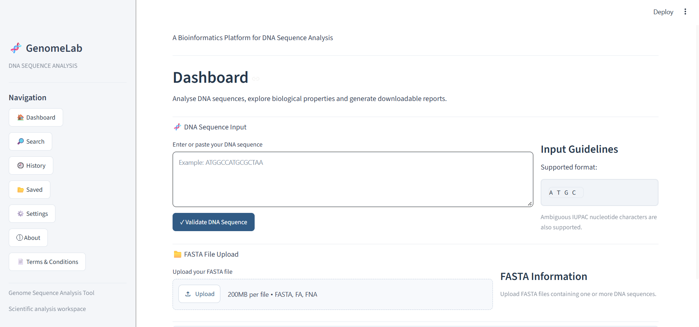
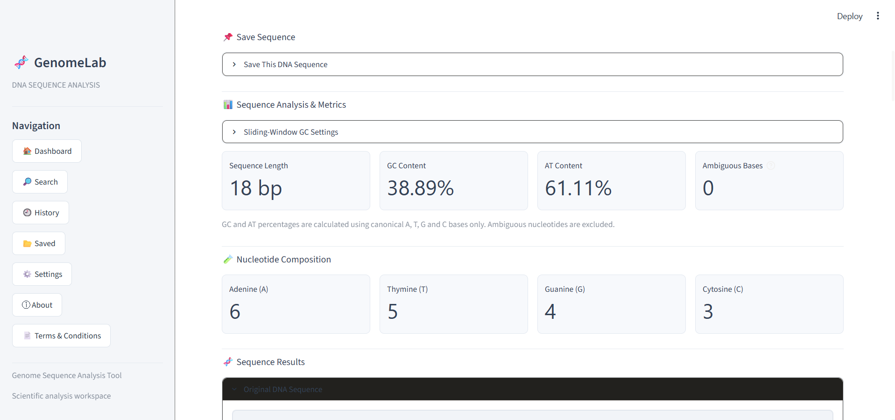
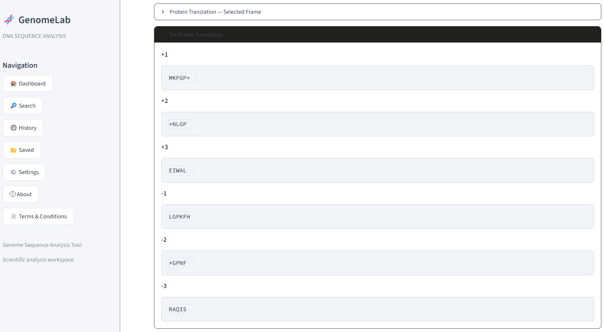
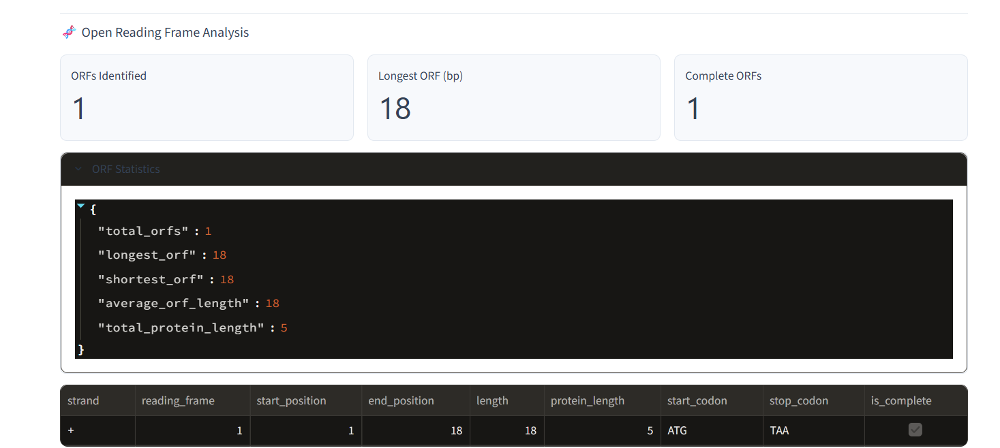
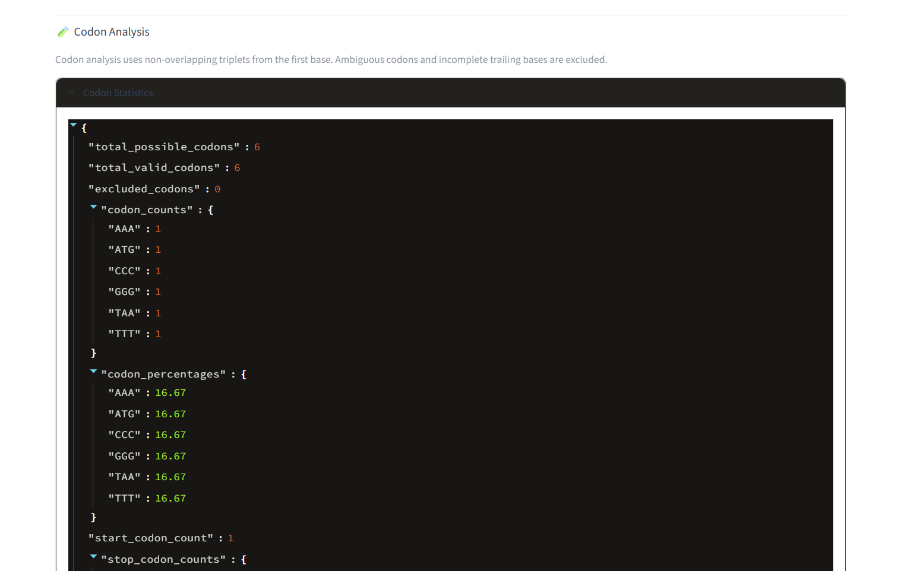
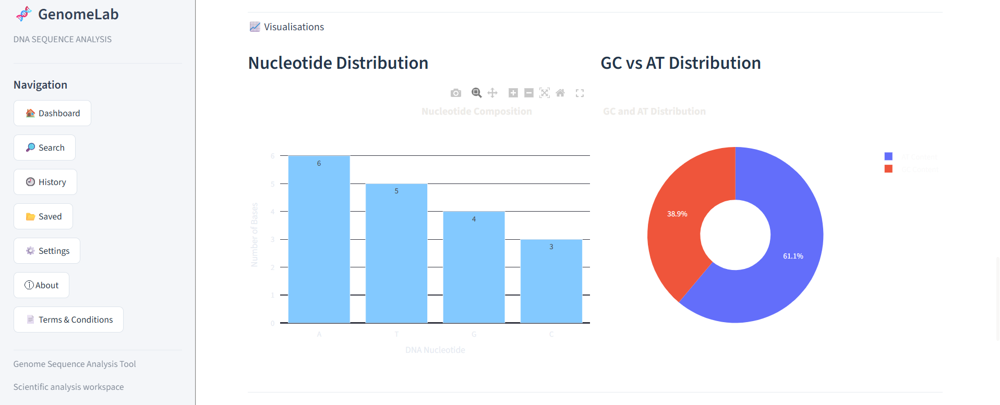
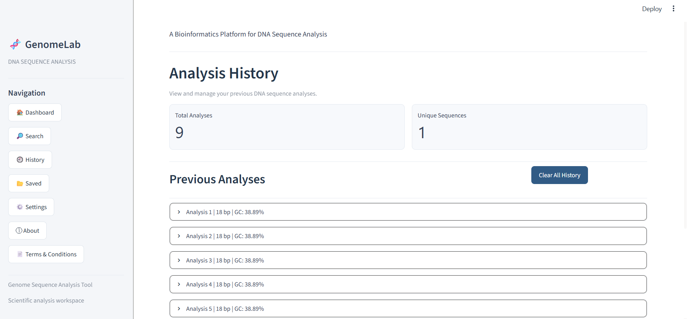
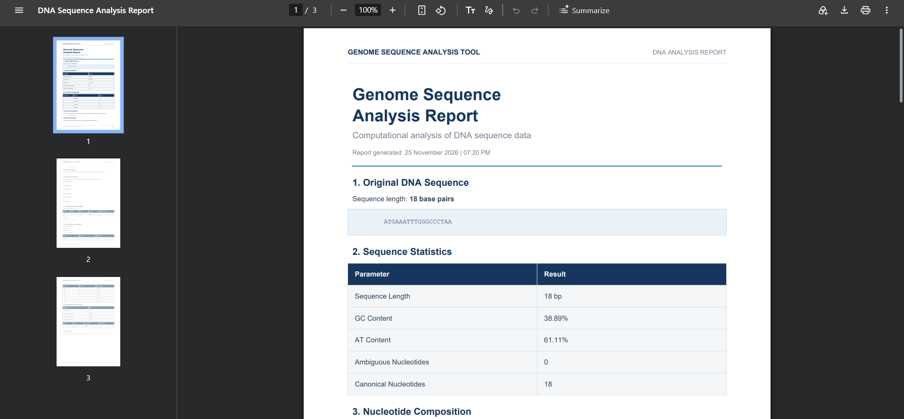

# DNA Sequence Analysis Tool

An interactive bioinformatics application for DNA sequence analysis, genetic code interpretation and genomic data visualisation.

Built using Python and Streamlit, this project provides an accessible environment for performing fundamental and advanced DNA sequence analyses through an intuitive web interface.

---

## Overview

The DNA Sequence Analysis Tool is designed to simplify common bioinformatics workflows by combining sequence processing, biological analysis, interactive visualisation and report generation in one application.

Users can analyse DNA sequences manually or upload FASTA files, explore different reading frames, identify open reading frames, investigate codon frequencies and examine GC-content distribution.

## Features

### 1. DNA Sequence Analysis
- DNA sequence validation and cleaning.
- Sequence length calculation.
- Nucleotide composition analysis.
- GC and AT content calculation.
- Ambiguous nucleotide identification.
- Reverse complement generation.
- DNA-to-RNA transcription.
- Protein translation.

### 2. Advanced Bioinformatics
- Six-frame translation.
- Open Reading Frame (ORF) identification.
- Start and stop codon detection.
- Codon frequency analysis.
- Codon usage statistics.
- Sliding-window GC content analysis.

### 3. Interactive Visualisation
- Nucleotide composition charts.
- Codon frequency distribution.
- GC-content distribution across sequence windows.
- ORF visualisation.

### 4. FASTA File Support
- FASTA file uploading and parsing.
- Multiple FASTA record support.
- Individual sequence selection.
- Sequence validation.

### 5. Sequence Management
- Analysis history.
- Save frequently used sequences.
- Reanalyse saved sequences.
- Delete individual records.
- Clear analysis history.

### 6. Report Generation

Export analysis results in three formats:

- PDF
- TXT
- CSV

PDF reports support additional scientific analysis sections, including ORF identification, codon statistics, six-frame translation and sliding-window GC analysis.

### 7. Application Settings
- Light and Dark themes.
- Default reading-frame selection.
- Preferred export format.
- Persistent application settings.

## Application Screenshots

### 1. Dashboard


### 2. DNA Sequence Analysis


### 3. Six-Frame Translation


### 4. ORF Analysis


### 5. Codon Analysis


### 6. Charts and Visualisations


### 7. History and Saved Sequences


### 8. PDF Report


---

## Technology Stack

| Technology | Application |
|---|---|
| Python | Core programming language |
| Streamlit | Interactive web application |
| Biopython | Bioinformatics toolkit |
| Pandas | Data processing and CSV generation |
| Plotly | Interactive visualisation |
| ReportLab | PDF report generation |
| Pytest | Automated testing |

---

## Project Structure

```text
dna-sequence-analysis-tool/
│
├── app.py
├── requirements.txt
├── README.md
├── .gitignore
│
├── modules/
│   ├── __init__.py
│   ├── sequence_io.py
│   ├── analysis.py
│   ├── orf_analysis.py
│   ├── codon_analysis.py
│   ├── gc_analysis.py
│   ├── visualisation.py
│   ├── pdf_report.py
│   └── storage.py
│
├── tests/
│   ├── __init__.py
│   ├── test_analysis.py
│   ├── test_sequence_io.py
│   ├── test_orf_analysis.py
│   ├── test_codon_analysis.py
│   └── test_gc_analysis.py
│
└── data/
    └── sample_sequences.fasta
```

---

## Installation and Setup

### Prerequisites

- Python 3.10 or later.
- pip package manager.
- Git.

### 1. Clone the repository

```bash
git clone https://github.com/AnshitSingh16/dna-sequence-analysis-tool.git
```

### 2. Navigate to the project directory

```bash
cd dna-sequence-analysis-tool
```

### 3. Create a virtual environment

```bash
python -m venv .venv
```

### 4. Activate the virtual environment

**Windows PowerShell**

```powershell
.\.venv\Scripts\Activate.ps1
```

**Windows Command Prompt**

```cmd
.venv\Scripts\activate.bat
```

**Linux/macOS**

```bash
source .venv/bin/activate
```

### 5. Install dependencies

```bash
pip install -r requirements.txt
```

### 6. Launch the application

```bash
streamlit run app.py
```

The application will open in your default web browser.

---

## Example DNA Sequence

Use the following sequence to explore the application:

```text
ATGAAATTTGGGCCCTAA
```

Expected basic analysis:

| Parameter | Result |
|---|---|
| Sequence Length | 18 bp |
| GC Content | 38.89% |
| AT Content | 61.11% |
| RNA Sequence | AUGAAAUUUGGGCCCUAA |
| Protein Translation | MKFGP* |
| Start Codon | ATG |
| Stop Codon | TAA |

---

## Running Tests

The project uses Pytest for automated testing.

Run all tests:

```bash
pytest
```

For detailed test output:

```bash
pytest -v
```

---

## Scientific Methodology

The application follows several basic biological and computational principles:

- DNA sequence validation supports standard IUPAC nucleotide symbols.
- Ambiguous nucleotides are excluded from canonical GC and AT calculations.
- Protein translation uses the standard genetic code.
- Incomplete trailing codons are excluded from translation.
- Six-frame translation examines three reading frames on each strand.
- ORF identification examines start-to-stop codon regions on forward and reverse strands.
- Codon frequency analysis excludes ambiguous codons.
- Sliding-window GC analysis evaluates nucleotide composition across configurable sequence windows.

Results should be interpreted according to the biological context and assumptions of each analytical method.

---

## Future Development

Potential directions for expanding the project include:

- DNA sequence alignment.
- BLAST integration.
- Genome annotation.
- Sequence similarity analysis.
- Mutation and variant analysis.
- Additional genomic visualisations.
- Analysis of larger genomic datasets.
- Expanded biological datasets and testing.

---

## Disclaimer

This project is intended for educational, computational biology and research purposes.

It is not designed or validated for clinical diagnosis or medical decision-making.

---

## Author

**Anshit Singh**

Independent Bioinformatics & Computational Biology Project.

**Areas:** Bioinformatics | Computational Biology | Genomics | Python | Data Visualisation

---

**Repository:** https://github.com/AnshitSingh16/dna-sequence-analysis-tool